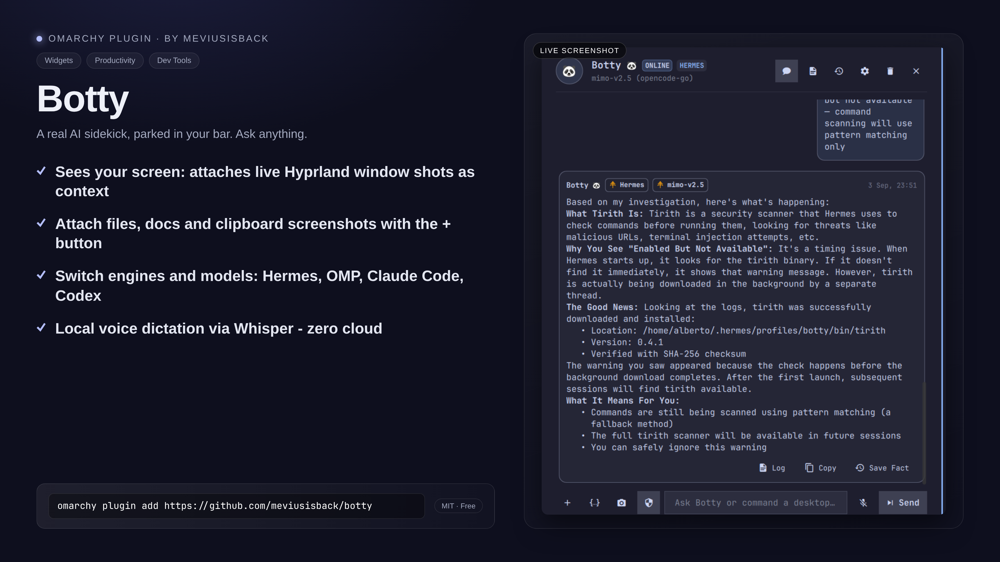
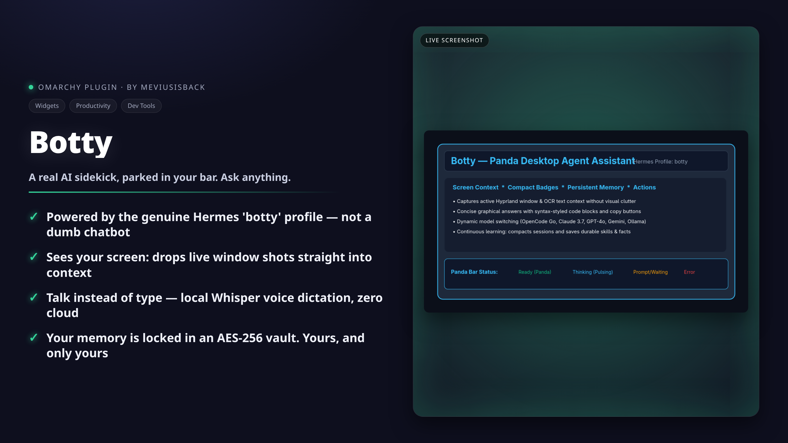

<div align="center">

# Botty

**Your Omarchy bar widget for agentic work.** Instant screen awareness, file and voice context, model switching and persistent memory — chat with Hermes, OMP, Claude Code or Codex without leaving your top bar.

[](LICENSE)






</div>

## Why it exists

The loop is always the same: **read** what's on screen, **decide** what to ask, **delegate** to the right agent. Botty keeps all three in one bar widget — no terminal juggling, no pasting screenshots, no losing the thread while the model thinks.

| Read | Decide | Delegate |
|---|---|---|
| Ambient Hyprland window capture attached as visual context | Status-aware bar icon: ready, thinking, waiting, error | Hermes, OMP, Claude Code or Codex engines, switchable in Settings |
| Universal `+` attachments: code, docs, media, clipboard screenshots | Searchable model catalog (on the Hermes engine, only providers with a key) | Sandbox Mode with proposal-gated writes and one explicit approval per execution |
| Persistent memory tab with single-click deletion | Voice dictation via local Whisper (`voxtype`) | Desktop automation actions: terminal, files, Hyprland, system apps |

## What it does

- **Native Omarchy bar widget.** Status-aware icon: steady panda when ready/done, pulsing spinner while thinking, amber prompt indicator, urgent red on error.
- **Ambient visual screen awareness.** Captures active Hyprland windows and attaches screenshots directly for multimodal models — no raw OCR dump clutter.
- **Universal file and context attachments (`+`).** One button for code files, documents and media; the file chooser floats centered without disturbing your tiling layout. Right-click `+` to attach a clipboard screenshot instantly.
- **Voice dictation.** Record with PipeWire and transcribe locally via `voxtype` (Whisper).
- **Multi-agent and model switching.** Toggle between **Hermes Agent (Botty)**, **OMP**, **Claude Code** and **OpenAI Codex**; on the Hermes engine the model catalog lists the providers the profile is set up for: those whose API key appears in `~/.hermes/.env` or in the profile's own `.env`, the provider the profile is currently using, and `ollama` when its `config.yaml` has an `ollama:` section (the OMP, Claude Code and Codex lists come from their own local caches or fixed provider lists).
- **Continuous learning and memory.** Single-click memory deletion from the Memories tab; AES-256 encrypted local vault backup (owner-only `0600`/`0700` permissions are the real protection — sources stay plaintext on disk).
- **Desktop automation actions.** Runs terminal commands, manages files, and interacts with Hyprland and system apps.

## Install

1. Create the Hermes profile Botty drives — the engine appears once the `hermes` binary is on `PATH`, but asks fail without that profile, so create it before the first request:

```bash
hermes profile create botty
```

Install the engine's own tools (`hermes`, plus `ffmpeg`, `grim`, `wl-clipboard`, `openssl`) and, for voice dictation, `voxtype` with a local Whisper model.

2. Install the plugin:

```bash
omarchy plugin add https://github.com/meviusisback/botty --enable
```

3. Add keybinds to your Hyprland bindings file (e.g. `~/.config/hypr/bindings.lua`) and floating file-dialog rules to `~/.config/hypr/hyprland.lua` (see Usage), then:

```bash
hyprctl reload
omarchy restart shell
```

## Usage

| Key | Does |
|---|---|
| `SUPER + A` | Toggle Botty — opens/closes the widget and auto-focuses the chat input |
| `SUPER + SHIFT + A` | Ask with window context — attaches the active window's app, title and folder as text (no screenshot), opens Botty focused |

Bindings (add to `~/.config/hypr/bindings.lua`):

```lua
o.bind("SUPER + A", "Toggle Botty", "omarchy-shell -q meviusisback.botty toggle")
o.bind("SUPER + SHIFT + A", "Botty with window context", "omarchy-shell -q meviusisback.botty situationContext")
```

Floating file dialogs (add to `~/.config/hypr/hyprland.lua`):

```lua
o.window({ title = ".*Attach File.*" }, { float = true, center = true, size = { 740, 500 }, stay_focused = true })
o.window({ title = ".*(Open File|Select File|Choose File|Open Folder|Save File).*" }, { float = true, center = true, size = { 740, 500 }, stay_focused = true })
o.window("xdg-desktop-portal.*", { float = true, center = true, size = { 740, 500 } })
```

Long-running requests get **600 seconds** by default before a timeout is reported. Override it in `~/.local/share/botty/config.json` (other keys may sit alongside it):

```json
{
  "request_timeout_seconds": 900
}
```

## Requirements

| Dependency | Purpose |
|---|---|
| Omarchy (Hyprland + Quickshell shell) | The host desktop this widget runs in |
| [`hermes`](https://github.com/NousResearch/hermes-agent) CLI | The agent engine behind the default profile |
| A Hermes profile named `botty` (`hermes profile create botty`) | Botty's agent profile, memory, and skills |
| `grim` | Screenshot capture for visual screen context |
| `wl-clipboard` (`wl-copy`/`wl-paste`) | Clipboard image attach and copy-out |
| `openssl` | AES-256 vault backup |
| `ffmpeg` (PulseAudio/PipeWire input) | Voice dictation recording |

Optional engines (switch in Settings): `omp`, `claude`, `codex`. Optional voice: [`voxtype`](https://github.com/NousResearch/voxtype) with a local Whisper model. Non-Omarchy Hyprland setups work if the binaries exist, but notifications and summons rely on Omarchy's shell helpers (`omarchy-shell`, `omarchy-notification-send`).

## Configuration

Widget settings (Omarchy plugin settings UI, defaults from `manifest.json`):

| Key | Type | Default | Notes |
|---|---|---|---|
| `refreshIntervalSec` | integer 1–30 | `2` | Seconds between status polls while the agent is working (off otherwise) |
| `barDisplay` | `Icon` / `Status` / `Compact` | `Icon` | Glyph only, headline ticker, or the bare status word in the bar |
| `showStatusInBar` | boolean | `true` | Status colour and the activity dot on the bar icon |

Agent request timeout lives in `~/.local/share/botty/config.json` as `request_timeout_seconds` (positive seconds, default `600`; invalid values fall back to the default).

## How it works

**Sandbox Mode (Hermes engine) is technically enforced, with one explicit human-approved execution window — and that enforcement depends on the profile's own approval gate (`approvals.single_query_mode`, `approvals.mode`, `command_allowlist`); when that config weakens the gate, Botty says so instead of claiming a boundary it cannot enforce.** Sandboxed runs launch `hermes` without `--yolo`, so Hermes's own approval gate applies; when a task needs writes, the agent proposes concrete actions and Botty shows an approval card. Clicking **Approve** runs one follow-up in a fresh, empty session whose prompt is the human-approved proposal itself.

| Layer | Guarantee |
|---|---|
| Prompt transport | Prompts travel via stdin or owner-only files (`0600`/`0700`), never in process `argv` |
| Learning | Compaction output is staged as proposals you approve one by one — nothing becomes memory or skill without review |
| Rendering | Agent text is plain text (no markdown/HTML), so crafted answers can't trigger remote loads or spoofed chrome |
| Memory files | Writable by any process running as you (`0600` owner-only) — staging is a review workflow, not integrity protection |
| Screen captures | Written `0600` inside a `0700` folder and pruned to the newest 20, so old desktops do not stay on disk |
| Non-Hermes engines | Refused outright while Sandbox Mode is on; with it off they run under their own permission models |
| Sandbox Mode off | Turns run without `--yolo` (the engine keeps its own permission model) and no approval card is shown automatically; approving a proposal still starts one explicit bypass run |

## Docs

- [FIX_SUMMARY.md](FIX_SUMMARY.md) — what the context/compaction hardening changed and why
- [BUG_ANALYSIS.md](BUG_ANALYSIS.md) — the original failure analysis behind that fix

## Contributing

```bash
python -m unittest discover -p 'test_*.py'   # every backend suite (security, compaction, preamble, clear-chat, cleanup, helpers)
node test_model_sanitize.js   # Model.js sanitizer, pure JS, no Qt needed
./redeploy-botty.sh           # copy Panel.qml + botty_backend.py to the installed plugin and restart the shell
```

## Removal

```bash
omarchy plugin remove meviusisback.botty
```

This removes the plugin from the bar and deletes `~/.config/omarchy/plugins/meviusisback.botty/`. To also wipe Botty's own data (chat history, memories, captures):

```bash
rm -rf ~/.local/share/botty
```

Your Hermes profile (`~/.hermes/profiles/botty`) is a separate Hermes resource and is not touched; remove it manually for a full purge.

## License

MIT — see [LICENSE](LICENSE).
